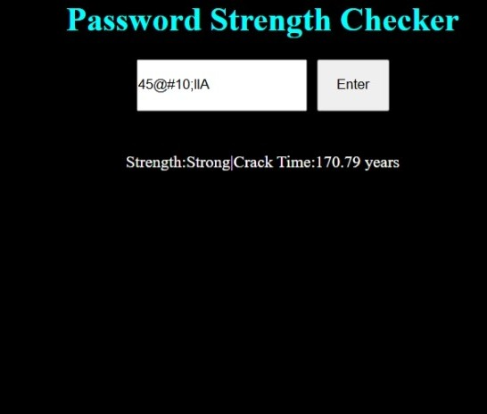

#Password Strength Checker A web app that rates how strong a password is and estimates how long would it take to crack the password entered. ##Features Strength rating:Weak,Medium,Strong crack time estimate based on password length and charcter type live web interface 
##Tech Stack Python,Flask,flask-cors,HTML,CSS,JAVASCRIPT 
##How to run 
1.Install dependencies:'pip install flask flask-cors' 
2.Start the Backend:'python app1.py' 
3.open 'frontend.html' with live server in vs code 
##how it works The checker counts which character types a password uses to get a pool size.The number of possible combinations is the pool size raised to the passwords length.Dividing by an assumed 10 billion guesses per second gives the estimate crack time. 
##Note The crack time figure isan estimate ,and this poject is for learning.A real password manager is the better way to keep passwords safe.
